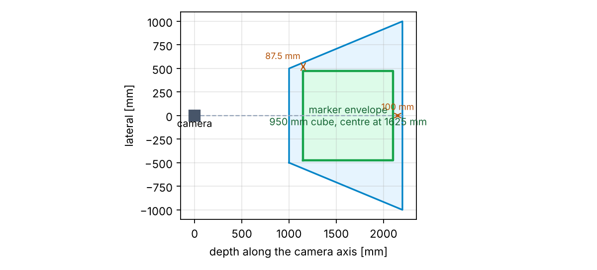
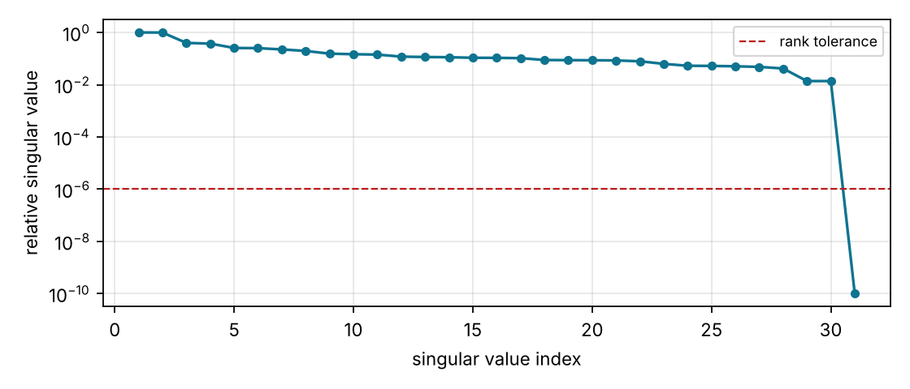

# Problem statement and goals

A Cartesian robot (three orthogonal linear stages) carries a spherical wrist and a tool holder.
Its controller knows only the *nominal* kinematics
$$\mathbf F_{ee}(\vec\theta)=\mathrm{Trans}(\theta_1\vec d_1+\theta_2\vec d_2+\theta_3\vec d_3)\,\mathrm{Trans}(500,0,0)\,
\mathbf R(\vec n_4,\theta_4)\mathbf R(\vec n_5,\theta_5)\mathbf R(\vec n_6,\theta_6)\,\mathrm{Trans}(100,0,0),$$
while the real robot has tilted axes ($\vec d^*_k=\mathbf R(\vec\phi_k)\vec d_k$, $\|\vec\phi_k\|\le 0.02$ rad for $k=2\ldots 6$),
systematic and random joint errors ($\theta^*_k=\theta_k+\Delta\theta^{sys}_k(\theta_k)+\Delta\theta^{rnd}_k$),
a tool-frame error ($\mathbf F^*_{we}=\mathbf F_{we}\Delta\mathbf F_{ee}$) and an uncertain base pose
($\mathbf F^*_{rob}=\Delta\mathbf F_{rob}\mathbf F_{rob}$). Uncalibrated, the end effector is several
millimetres from where the controller thinks it is (Table \ref{tab:fwd}: 7.070 mm rms, up to
16.10 mm and 5.60e-02 rad on the test grid).

An optical tracker observes a calibration marker body whose coordinate system *is* $\mathbf F_{ee}$.
Our program must design the scene, collect tracker data against a simulated clock, and deliver
`ImprovedFwdKins` / `ImprovedInvKins` that are accurate to $\|\vec\epsilon\|\le 0.2$ mm and
$\|\vec\alpha\|\le 10^{-3}$ rad over the whole work volume, in as little simulated time as possible
(soft budget 900 s), with the program itself finishing in under 10 minutes of real time.

**Result in one line.** Method 1 of the handout (one joint at a time from home) with a 31-parameter
least-squares model reaches 0.118 mm / 3.48e-04 rad worst case
for `ImprovedFwdKins` and 0.115 mm / 4.94e-04 rad for `ImprovedInvKins`
on the fixed 729-pose test grid (seed 1), using 389 s of simulated
calibration time; all 3 seeds tried meet both targets (Table \ref{tab:fwd}).

# Scene design (Step 1)

## Where the markers can be

The wrist centre reaches $x\in[500,1100]$, $y\in[-300,300]$, $z\in[0,600]$ mm (base coordinates).
The end effector is 100 mm beyond the wrist centre and the calibration markers at most 75 mm beyond
that, so **every marker of every reachable pose lies inside a cube of half-size 475 mm centred at
(800, 0, 300) mm** — the *marker envelope*. We design visibility for the whole envelope rather
than for a grid of poses, so no pose needs to be checked at run time.

## Tracker pose

The viewing volume (handout Figure 2) is a frustum along the camera's $+z$ axis: depths 1000–2200 mm,
half-width 500 mm at the near face growing to 1000 mm at the far face. We place the camera
**1625 mm above the envelope centre, looking straight down** (`design.tracker_pose()`):

| quantity | value |
|---|---|
| envelope depth range | 1150 – 2100 mm (frustum: 1000 – 2200 mm) |
| lateral margin at the envelope's near face | 562.5 − 475 = **87.5 mm** |
| depth margin to the far face / near face | **100 mm** / 150 mm |
| worst-case shift of the real base ($0.05\,\mathrm{rad}\times1566\,\mathrm{mm}+5\,\mathrm{mm}$) | 83 mm |

Table: Visibility margins of the marker envelope for the chosen tracker pose.

The margin exceeds the worst-case placement error of the robot base, so the body is visible at
every pose for every admissible $\Delta\mathbf F_{rob}$. The handout sets the tracker jiggle to zero,
so this pose is exact and the tracker frame is our fixed reference. Moving the camera closer
would lose lateral margin at the near face; further would lose depth margin (Figure \ref{fig:frustum}).

{width=80%}

## Robot pose

$\mathbf F_{rob}=\mathbf I$: the base is placed at the workspace origin. The choice is arbitrary
because the real base pose is one of the calibrated parameters.

## Calibration body

Eight markers on the corners of a cube with circumradius 74.99 mm (the largest allowed is 75 mm; the 0.01 mm keeps the corner coordinates inside the limit after rounding), `design.mbee_layout()`.
With isotropic marker noise $\sigma_b$ the orientation error of one registration about an axis $\vec u$ is
$\sigma_b/\sqrt{\sum_k|\vec a_k\times\vec u|^2}$; for this layout the sum is $8\cdot75^2\cdot\tfrac23=30000$ mm$^2$
for every $\vec u$ (the layout is isotropic), giving **$5.8\times10^{-4}$ rad** and $0.1/\sqrt8=0.035$ mm per
reading. A six-marker octahedron of the same radius gives $6.7\times10^{-4}$ rad; the cube is the best use of the
allowed size. We define no additional marker bodies: there is no tracker jiggle to compensate, and their layouts
are only known to ±2 mm.

# Error model and error budget

## Which specifications matter

| spec-sheet item | value | effect if ignored | how we handle it |
|:----------|:----------|:-----------|:-----------|
| axis tilts $\vec\phi_k$ | ≤ 0.02 rad | up to $0.02\times600=12$ mm and 0.02 rad | 10 tilt parameters (2 per axis) |
| joint distortion, wrist | ≤ 0.01 rad, slope ≤ $5\times10^{-5}$ | 1 mm at the tool, 0.01 rad | homing offset + linear term |
| joint distortion, slides | ≤ 0.2 mm, slope ≤ $5\times10^{-4}$ | 0.2 mm | homing offset + quadratic |
| tool frame $\Delta\mathbf F_{ee}$ | ≤ 0.01 rad, 0.5 mm | 0.5 mm, 0.01 rad everywhere | 6-parameter tool twist |
| base placement | ≤ 0.05 rad, 5 mm | only matters for visibility | 6-parameter base twist (5 fitted) |
| joint random error | $\sigma$ = 0.005 mm, $10^{-4}$ rad | ≈ 0.02 mm, $2\times10^{-4}$ rad | cannot be calibrated: error floor |
| tracker noise $\sigma_b$ | 0.1 mm / marker | $5.8\times10^{-4}$ rad / reading | average M readings per pose |
| tracker systematic field | ≤ 0.1 mm, gradient ≤ $7.5\times10^{-4}$ | ≤ 0.1 mm per point, slowly varying | cannot be calibrated: error floor |
| tracker jiggle | 0 | — | — |
| motion limits | 50 mm/s, 0.1 rad/s | sets the time | plan order, sweep length |

Table: The spec sheet, sorted by what it does to the error budget.

## Sample spacing from the slope bounds (method 1, step a)

If an error $e(\theta)$ has slope $|e'|\le\omega$ and is sampled every $h$, linear interpolation
between samples is off by at most $\omega h/2$ (the worst case is a "tent" between two samples).
Giving interpolation one tenth of the position budget ($\varepsilon=0.02$ mm) requires
$h\le 2\varepsilon/\omega = 2\cdot0.02/5\times10^{-4}=80$ mm on the slides; 600 mm is not a multiple of
80, so we use **$h=75$ mm, 9 stops per slide**. For the wrist the same bound between home and the
end of the travel gives $5\times10^{-5}\times2.36=1.2\times10^{-4}$ rad, well inside the budget, so the
wrist distortion is modelled as the **homing offset plus a linear term** and needs no dense sampling.
Our fitted model is a polynomial rather than an interpolating table, so the bound is not binding;
we kept the spacing because it also resolves the distortion's slowest ripple (period ≥ 180 mm) and
averages tracker noise along the axis. Section \ref{sec:tradeoff} shows that 150 mm would have worked
as well.

The tracker's systematic field is the one error that *no* spacing improves: it is the same every
time at the same place, up to 0.1 mm, and it limits what the calibration can achieve.

## Readings per pose from the noise

We give tracker noise one tenth of the orientation budget, $10^{-4}$ rad, so
$M=\lceil(5.8\times10^{-4}/10^{-4})^2\rceil=\mathbf{34}$ readings per pose ($\sigma/\sqrt M$), taken as
5 commands × 7 readings = 35. A reading costs 0.03 s and a re-command 0.05 s, so a pose costs 1.3 s of
sampling — far less than the 2–20 s moves. This sizing is done by `workflow.plan_calibration_poses` from
`desired_accuracy`.

## Error budget

| source (after calibration) | position | orientation |
|:------------------|:----------|:----------|
| tracker systematic field (floor) | ≤ 0.1 mm per point | ≤ $\sim 10^{-4}$ rad (field gradient × body size) |
| joint random error (floor, at test time) | ≈ 0.02 mm | ≈ $2\times10^{-4}$ rad |
| tracker noise, M = 34, averaged further over ~50 poses | ≈ 0.01 mm | ≈ $3\times10^{-5}$ rad |
| model truncation (ripple not in the polynomial) | ≤ 0.01 mm | ≤ $10^{-4}$ rad |
| **expected total** | **≈ 0.1 mm typical, < 0.2 mm worst case** | **≈ $3\times10^{-4}$ rad, < $10^{-3}$ worst case** |

Table: First-order error budget. \label{tab:budget}

# Calibration method

## Pose plan (method 1, step b) {#sec:plan}

The handout's method 1, with one change: the plan is *home, then sweep each joint on its own while
the other joints rest at their home value*, and the robot does **not** return home between sweeps —
the first stop of the next sweep moves the previous joint back in the same command (the move time
is set by the slowest joint), which saves about 85 s of simulated time with no measurable loss of
accuracy (we tested both). The plan for seed 1:

* one home pose;
* slides 1–3: 9 stops each, 75 mm apart (27 samples);
* wrist 4–6: stops at -2.00, -1.00, 1.00, 2.00 rad (12 samples);
* every pose is commanded 5 times in a row with 7 tracker readings each
  (35 readings per pose); all readings of a pose are averaged on the raw marker positions
  and registered once, so the fit sees one low-noise sample per pose;
* in total 40 poses / 200 commands, predicted 305 s
  (263 s motion + 42 s sampling), measured 305 s.

Joints 1–3 are kinematically decoupled from 4–6: a slide sweep moves the end effector along a
straight line (direction = the real axis, distance = the real travel) with the orientation
unchanged, and a wrist sweep rotates it about a fixed point (the wrist centre) about the real axis.
Every parameter of the model is therefore excited by exactly one sweep, and the ten baseline poses
of Step 6 (already paid for) are added to the data set.

Re-commanding a pose, as the handout suggests, costs only $t_{settle}=0.05$ s and re-rolls the joint
repeatability noise ($10^{-4}$ rad per wrist joint — the same size as the tracker noise after averaging), so
the 35 readings of a pose are split over 5 commands.
Section \ref{sec:tradeoff} shows that this lowers the orientation error by about 30 % for 9 s of extra time.

## Parameterization (method 1, step c)

`kinematics.ImprovedKinematics` (numerics in `src/student/_core.py`) uses the parameter vector

| params | meaning | count |
|:-------|:---------------------------|---:|
| $\vec\xi_X$ | twist of the base frame, $\mathbf F_X=\mathbf F_{X,init}\,\mathrm{Exp}(\vec\xi_X)$ | 6 |
| $(t_1,t_2)$ for $\vec d_2,\vec d_3,\vec n_4,\vec n_5,\vec n_6$ | tilt in the plane perpendicular to the nominal axis | 10 |
| $\vec\xi_{we}$ | twist of the tool frame, $\mathbf F_{we}=\mathbf F_{WE}\,\mathrm{Exp}(\vec\xi_{we})$ | 6 |
| $c_{k,j}$ | $\Delta\theta^{sys}_k=\mathrm{offset}_k+\sum_j c_{k,j}(\theta_k/\theta^{max}_k)^j$, degree 2 (slides), 1 (wrist) | 9 |

Table: Parameter vector (31 parameters; all zeros = the nominal robot at $\mathbf F_{X,init}$).

The joint **offsets are not fitted**: they come from `HomeRobot()`, which drives the robot to
$\theta^*=0$ and returns the encoders, $-\Delta\theta^{sys}(\mathrm{home})-\Delta\theta^{rnd}$. Five
homings cost $4\,t_{settle}$ after the first and reduce the random part by $\sqrt5$. A slide offset is
indistinguishable from a shift of the base along that axis, so it could not be fitted anyway.
The wrist distortion is linear because the handout's slope bound ($5\times10^{-5}$) limits any curvature
to $\sim10^{-4}$ rad over the travel; a quadratic wrist term only fits noise and made results worse
(Section \ref{sec:tradeoff}). The tilt of an axis has two parameters: a rotation about the axis itself
does not change it.

## Least-squares fit

For every sample $j$ the residual is the pose error $\mathbf D_j=\big(\mathbf F_X\,\mathbf F_{ee}(\vec\theta_j)\big)^{-1}\mathbf F_{obs,j}$,
stacked as $[\,w\,\mathrm{Log}(\mathbf D_j.R);\ \mathbf D_j.p\,]$ with $w=200$ mm/rad so that the handout's
$10^{-3}$ rad counts like its 0.2 mm. `fit` runs `scipy.optimize.least_squares` (Levenberg–Marquardt, central-difference
Jacobian) from the nominal model with $\mathbf F_{X,init}$ from `estimate_base_frame` (the average of
$\mathbf F_{obs,j}\,\mathrm{FwdKins}(\vec\theta_j)^{-1}$ over the samples). The real robot differs from the
nominal one by only 1–2 %, so 5 function evaluations suffice; the final residuals are
0.029 mm rms / 0.077 mm max in position and
4.92e-04 rad rms in orientation — i.e. the model explains the measurements down to
the tracker's own noise and field.

## Identifiability (the Jacobian rank report)

`jacobian_rank_report` differentiates the residual numerically and reports the singular values of the
Jacobian (columns scaled to a common unit). With **all 31 parameters free the rank is
30**: exactly one direction is invisible to the tracker, and its singular vector is
`tilt_axis2_x`, `tool_alpha_x`, `tilt_axis3_x`, `base_alpha_x`, `tilt_axis6_x`, `tilt_axis5_x` with equal weights (Figure \ref{fig:sv}). This is the *gauge* of the base frame: rotating
the base about $\vec d_1$ while tilting $\vec d_2,\vec d_3,\vec n_5,\vec n_6$ and the tool frame by the opposite
angle about $\vec d_1$ produces identical tracker observations ($\vec n_4\parallel\vec d_1$ is unaffected,
and $\mathbf F_{cw}$ lies along $\vec d_1$). The tracker only ever sees the product $\mathbf F^*_{rob}\mathbf F^*_{ee}$;
$\vec d_1$ fixes the base $x$ axis and the wrist centre fixes the origin, but nothing fixes the rotation
about $x$. We therefore **freeze $\xi_{X,\alpha_x}$** (`fix_gauge=True`), which defines the base frame as
"the $x$-rotation of $\mathbf F_{X,init}$"; the remaining 30 parameters have full rank with
condition number 73. Predictions in the tracker frame, `predict_in_tracker`, do not
depend on the gauge, and the handout's evaluation metric is formulated there.

Two more non-identifiable quantities are excluded by construction, as discussed above: the component
of $\vec\phi_k$ along $\vec d_k$, and the slide offsets (versus the base position). Because of the
gauge, *axes and tilts should be compared with ground truth through gauge-free quantities* — the
angles between axes, the joint scale factors, and end-effector poses — or after removing the
gauge rotation with the true base frame (`compare_with_ground_truth`), which is what Table \ref{tab:params} does.

{width=70%}

## Improved forward and inverse kinematics (method 1, step d)

`ImprovedFwdKins`: $\theta^*_k=\theta_k+\Delta\theta^{sys}_k(\theta_k)$, then the nominal chain with the
calibrated axes and tool frame. `ImprovedInvKins` is the provided iterative solver (Levenberg–Marquardt
on the pose error, both wrist branches, nearest in-limit solution); it works on our `fwd_kins`
unchanged and converges in a few iterations because the model is within 1–2 % of the nominal one.

# Software and unit tests

| module | contents |
|:----------------|:---------------------------|
| `src/student/design.py` | Step-1 design values (tracker pose, robot pose, marker layout, envelope) |
| `src/student/metrics.py` | `frame_error` (log map, exact for large angles), `summarize_errors` (+ p95, target fraction) |
| `src/student/registration.py` | Arun registration (own implementation; rejects < 3 or collinear points, fixes reflections), `average_frames` (chordal mean), `refine_marker_body` |
| `src/student/workflow.py` | `measure_home_offsets`, `plan_calibration_poses` (sizing from accuracy, visibility with margin, time prediction), `collect_calibration_data`, `estimate_base_frame`, `merge_data`, `order_poses_by_motion_time` |
| `src/student/kinematics.py` | `ImprovedKinematics`: parameterization, `fwd_kins`, `residuals`, `fit`, `jacobian_rank_report`, `parameters_report`, `compare_with_ground_truth` |
| `src/student/_core.py` | pure-numpy se(3) math, the parameter model, Jacobian, least squares, rank analysis, plan-sizing formulas |
| `src/student/_convert.py` | conversions between the course's `Frame`/`Rot`/`vct3` and numpy arrays |
| `report/variant_study.py` | the 10-seed pose-plan trade-off study of Section \ref{sec:tradeoff} |
| `tests/test_student.py` | 30 unit tests (below) |

Table: Software layout.

`tests/test_student.py` keeps every test the course shipped, implements the three it left as `TODO`, and
adds tests for the remaining components. All 30 tests pass (53 passed in 18 s (23 provided + 30 ours), run on 2026-10-31).

| # | component | test | pass criterion |
|:-|:------------------|:--------------------------|:----------------|
| 1 | `frame_error` | known values; invariance to a common left factor; 2.5 rad rotation; offset measured in the reference frame | exact to $10^{-9}$ |
| 2 | `summarize_errors` | rms / max / target fraction on hand-made lists; empty input | exact |
| 3 | `register_points` | recovers a random frame from 6 points | $10^{-9}$ |
| 4 | `register_points` | 2 points, collinear points, mismatched lengths | `ValueError` |
| 5 | `register_points` | 300 noisy registrations of the 8-marker body | rms position 0.03–0.09 mm, orientation $(0.5\text{–}1.5)\times10^{-3}$ rad, proper rotation |
| 6 | `average_frames` | identical frames; proper rotation; 100 noisy frames | exact; $R^TR=I$; noise reduced to ~1/10 |
| 7 | `refine_marker_body` (TODO) | body with manufacturing error, 30 readings | layout error shrinks > 3×, to < 0.15 mm; costs 30 × 0.03 s |
| 8 | design / visibility | envelope corners visible, also shifted by ±85 mm on every axis | all visible; 85 mm > worst-case base shift |
| 9 | `plan_calibration_poses` (TODO) | every planned pose within limits and visible with margin; every joint swept; 34 → 5 × 7 readings, h = 75 mm, 40 poses / 200 commands; impossible margin | `ValueError` |
| 10 | plan sizing | tighter accuracy → more readings and more time | monotone |
| 11 | `measure_home_offsets`; `order_poses_by_motion_time` | 20 homings vs the next homing's encoders; cost of 5 homings; vs true $\Delta\theta^{sys}(0)$; ordering 12 random poses shortens the travel | within $4\sigma_{rnd}$; one move + 4 $t_{settle}$ |
| 12 | `collect_calibration_data` | commands A, B, B × 4 readings: B merged into one sample with 8 readings, encoder values, clock cost (3 moves + 12 × 0.03 s), frames near truth | exact clock; < 0.3 mm / $2\times10^{-3}$ rad |
| 13 | `collect_calibration_data` | pose outside the frustum | skipped, recorded |
| 14 | `estimate_base_frame` | perfect nominal data; perfect data from a perturbed improved model after `merge_data` | exact |
| 15 | `ImprovedKinematics` | zero parameters = nominal kinematics; `inv_kins` round trip with perturbed parameters | $10^{-9}$; $10^{-6}$ mm / $10^{-8}$ rad |
| 16 | parameter layout | offsets at home; polynomial value and scale; a 0.01 rad tilt of $\vec d_2$ moves a 300 mm travel by 3 mm | exact |
| 17 | `residuals` | zero on self-generated data; $10^{-3}$ rad shows up as 0.2 mm-equivalent | $10^{-9}$ |
| 18 | `fit` (TODO) | noise-free data from a known non-zero parameter vector (gauge included), fitted from zero | poses reproduced to $10^{-5}$ mm; parameters differ (gauge), axis angles and scales agree |
| 19 | `jacobian_rank_report` | rank 31−1 with all parameters; weakest direction = gauge; full rank after fixing it | condition < $10^4$ |
| 20 | end to end | full pipeline on seed 0; 150 random poses vs `actual_ee_pose`; parameters vs truth (gauge-free) | < 0.2 mm, < $10^{-3}$ rad; $t_{cal}$ < 900 s; axis errors < 0.5 mrad; distortion functions within the tracker floor |

Table: Unit tests and their pass criteria (grouped; 30 test functions).

# Results

All numbers below come from `notebooks/assignment2_solution.ipynb` (`results/notebook_results.json`).
Ground truth (`rob.actual_ee_pose`, `rob.ground_truth_parameters`) is used only in the evaluation and
reporting steps, never in the calibration.

## Calibrated parameters versus ground truth (seed 1)

| quantity | estimated − true |
|:------------------------|:---------------|
| angles between axes (d1–d2, d1–d3, d2–d3, n4–n5, n4–n6, n5–n6), mrad | 0.056, 0.092, -0.027, -0.038, 0.066, -0.072 |
| axis direction errors after removing the base gauge (joints 1–6), mrad | 0.040, 0.069, 0.067, 0.080, 0.086, 0.094 |
| joint scale factors vs the best straight line through the true distortion (1–3 mm/mm; 4–6 rad/rad) | 6.7e-05, -2.6e-05, -5.0e-05, 2.3e-05, 5.5e-05, 7.3e-05 |
| joint distortion functions over the travel, max deviation (1–3 mm; 4–6 rad) | 2.9e-02, 2.9e-02, 2.3e-02, 7.6e-05, 1.5e-04, 2.5e-04 |
| joint offsets at home (joints 1–3, mm; 4–6, rad) | -4.7e-03, 7.2e-04, 1.3e-03, -2.2e-05, 2.3e-05, -2.3e-05 |
| tool frame (rad, mm) | 1.06e-04, 0.014 |
| base frame in the tracker (rad, mm; includes the gauge) | 5.82e-03, 0.090 |

Table: Parameter errors; the true angles are 90.0685, 90.1799, 88.3080, 91.8122, 90.1719, 89.3844 degrees. \label{tab:params}

The axes are recovered to a tenth of a milliradian, the wrist distortion to $\sim10^{-4}$ rad and the offsets
to the averaged repeatability noise. The slide distortion functions agree with the truth to a few hundredths
of a millimetre: the fit cannot distinguish a slide's scale error from the tracker field's variation along
that slide, so this residual is the field's (≤ 0.1 mm) — it is consistently reproduced in the tracker frame and
does not hurt the pose accuracy. (The handout's "joint scale" $s_k$ is not directly comparable with a fitted
linear coefficient because the ripple $\sigma\sin(A\theta+B)$ has a local slope of up to $\sigma A=3.5\times10^{-4}$;
we therefore compare with the slope of the best straight line through the true distortion.) The base frame
error is larger than the pose errors because the base origin lies 500 mm outside the measured region (it is
extrapolated from the wrist centre along $\vec d_1$) and because it contains the gauge rotation.

## Forward kinematics over the work volume (Step 9)

Fixed test grid: $3^6=729$ joint vectors (slides at 100/300/500 mm and −200/0/200 mm, wrist at
±1.3 rad and θ₆ at ±2.0 rad, all visible). Metric: $\mathbf D=(\mathbf F_{trk}^{-1}\mathbf F^*_{ee})^{-1}(\hat{\mathbf F}_X\,\mathrm{ImprovedFwdKins})$.

| seed | model | pos rms [mm] | pos max [mm] | ang rms [mrad] | ang max [mrad] | within target | target met |
|:--|:------|------:|------:|------:|------:|------:|:----:|
| 1 | nominal | 7.070 | 16.104 | 32.932 | 55.990 | 0% | no |
| 1 | **improved** | **0.080** | **0.118** | **0.211** | **0.348** | 100% | **yes** |
| 2 | nominal | 5.562 | 12.611 | 35.526 | 53.614 | 0% | no |
| 2 | **improved** | **0.062** | **0.108** | **0.235** | **0.445** | 100% | **yes** |
| 3 | nominal | 6.122 | 13.191 | 21.582 | 32.527 | 0% | no |
| 3 | **improved** | **0.065** | **0.109** | **0.347** | **0.572** | 100% | **yes** |


Table: `ImprovedFwdKins` versus the nominal kinematics on the test grid (targets 0.2 mm, $10^{-3}$ rad). \label{tab:fwd}

## Inverse kinematics (Step 10)

40 reachable targets (true poses of random test-grid joint vectors). For each, $\vec\theta=\mathrm{ImprovedInvKins}(\hat{\mathbf F}_X^{-1}\mathbf F)$,
the robot is moved there and the actual placement of the calibration body is compared with the
target. Every real move includes the joint repeatability noise ($\sigma=0.005$ mm, $10^{-4}$ rad), which puts
a floor of ≈ 0.02 mm / $2\times10^{-4}$ rad under this number.

| seed | model | pos rms [mm] | pos max [mm] | ang rms [mrad] | ang max [mrad] | within target | target met |
|:--|:------|------:|------:|------:|------:|------:|:----:|
| 1 | nominal | 7.432 | 13.274 | 34.505 | 55.931 | 0% | no |
| 1 | **improved** | **0.083** | **0.115** | **0.292** | **0.494** | 100% | **yes** |
| 2 | nominal | 5.957 | 11.596 | 35.738 | 52.121 | 0% | no |
| 2 | **improved** | **0.066** | **0.098** | **0.291** | **0.609** | 100% | **yes** |
| 3 | nominal | 6.367 | 12.402 | 21.589 | 32.167 | 0% | no |
| 3 | **improved** | **0.066** | **0.088** | **0.372** | **0.742** | 100% | **yes** |


Table: `ImprovedInvKins` versus the nominal inverse kinematics (40 targets per seed).

## Time

| seed | homing + baseline [s] | sweeps [s] | **calibration total [s]** | testing (80 moves) [s] | commands | readings |
|:--|------:|------:|------:|------:|------:|------:|
| 1 | 84 | 305 | **389** | 481 | 200 | 1400 |
| 2 | 84 | 305 | **389** | 475 | 200 | 1400 |
| 3 | 84 | 305 | **389** | 458 | 200 | 1400 |


Table: Simulated time (soft budget 900 s). The baseline poses are the template's Step 6. The IK test's 80 moves (40 targets × nominal and improved) are visited in a greedy nearest-neighbour order, which halves the testing time of the template's random order (≈ 1080 s) — the wrist moves at 0.1 rad/s.

The whole notebook, including the three-seed repetition, runs in well under the 10-minute real-time
limit (see the notebook's last printed line); the 10-seed variant study is a separate script (about 6 minutes).

## Pose-plan / time trade-off {#sec:tradeoff}

Same pipeline with deliberately different plans, each on 10 robot seeds
(`report/variant_study.py`; forward error on the test grid, no baseline poses; rms values are means over the
seeds with their standard error, max values are the worst seed):

| plan | $t_{cal}$ [s] | cmds | rdgs | pos rms [mm] | pos max [mm] | ang rms [mrad] | ang max [mrad] |
|:------------------------|-----:|---:|---:|------:|------:|------:|------:|
| default: wrist ±1,±2; h 75; 5×7 readings | 290 | 200 | 35 | 0.062 | 0.108 | 0.120 ± 0.01 | 0.305 |
| 1 command × 34 readings | 281 | 40 | 34 | 0.063 | 0.117 | 0.174 ± 0.02 | 0.450 |
| wrist ±0.5,±1 rad | 202 | 200 | 35 | 0.065 | 0.124 | 0.211 ± 0.02 | 0.527 |
| wrist ±0.75,±1.5 rad | 245 | 200 | 35 | 0.065 | 0.118 | 0.154 ± 0.01 | 0.328 |
| wrist ±1.15,±2.3 rad | 317 | 200 | 35 | 0.063 | 0.106 | 0.123 ± 0.01 | 0.251 |
| slide step 150 mm | 274 | 140 | 35 | 0.065 | 0.106 | 0.124 ± 0.01 | 0.269 |
| 5×2 = 10 readings per pose | 260 | 200 | 10 | 0.066 | 0.144 | 0.225 ± 0.02 | 0.504 |
| 5×20 = 100 readings per pose | 368 | 200 | 100 | 0.064 | 0.098 | 0.105 ± 0.01 | 0.267 |
| wrist polynomial degree 2 | 290 | 200 | 35 | 0.062 | 0.107 | 0.140 ± 0.01 | 0.280 |
| slide polynomial degree 1 | 290 | 200 | 35 | 0.064 | 0.110 | 0.143 ± 0.01 | 0.316 |


Table: Design variants (10 seeds each; every variant met both targets on every seed).

What the table shows. (i) The **position** error is the same for every plan, ≈ 0.063 mm rms: it is set by the
tracker's systematic field, not by the plan. (ii) The **wrist sweep length** is the main lever on orientation:
±1 rad is almost twice as bad as ±2 rad, ±1.5 rad is in between, and ±2.3 rad brings nothing more — the
axis-direction error falls as $1/\Theta$ until the tracker's own orientation floor is reached. (iii) **Re-commanding**
each pose 5× (same number of readings) lowers the orientation rms by ~30 % for 9 s: it averages the joint
repeatability noise, which a single command cannot. (iv) **Readings per pose** follow $1/\sqrt M$: 10 readings
are clearly worse, 100 only slightly better than 35 at +78 s. (v) The **slide spacing** does not matter for a
polynomial model (150 mm is as good as 75 mm and 16 s faster; we kept 75 mm for the reasons in
Section 3.2). (vi) A **quadratic wrist** term and a **linear-only slide** term are both worse than our
(2, 2, 2, 1, 1, 1) choice, confirming the error model. The default plan sits at the knee of the time/accuracy curve.

# Discussion

**What limits the accuracy.** After calibration the residual error is dominated by the two floors
that no model can remove: the tracker's systematic field (≤ 0.1 mm, slowly varying, so it leaks a
fraction of itself into every parameter and into every "bottom line" tracker test) and, in the
inverse-kinematics test, the joint repeatability noise re-rolled at every move. The rms forward error
of ≈ 0.080 mm is consistent with the budget of Table \ref{tab:budget}.

**Identifiability shaped the design.** The rank report confirmed the gauge direction and led us to
(a) fix one base-twist component, (b) take the joint offsets from homing instead of the fit, and
(c) parameterize tilts with two components. Comparing parameters with ground truth has to respect
the gauge: raw tilt vectors disagree by a rotation about $\vec d_1$ even when the model is perfect,
which is why Table \ref{tab:params} reports gauge-free quantities.

**Wrist singularity.** At $\theta_5=\pm\pi/2$ (inside the ±0.75π range) axes 4 and 6 align and the inverse
kinematics is ill-conditioned; the provided solver handles it with damping and by trying both wrist
branches. The test grid avoids the exact singularity (±1.3 rad).

**Deviations from the template.** `plan_calibration_poses` accepts `return_info=True` and returns its sizing
(readings per command, predicted time); the notebook passes that number as `repeats` to
`collect_calibration_data` instead of the template's `repeats=1`, and `collect_calibration_data` averages the
readings of consecutive identical commands into one sample; the Step-6 baseline data are merged into the fit
(`workflow.merge_data`); the IK test visits its 40 targets in a travel-minimising order
(`workflow.order_poses_by_motion_time`); design values live in `src/student/design.py`; the robot does not
return home between sweeps. Everything else keeps the template's signatures.

**What we would do next.** A denser bottom-line tracker test ordered to minimise wrist travel; a
per-seed check of the variance of the fitted parameters from the Jacobian ($\sigma^2(J^TJ)^{-1}$) as a
confidence measure; and, if the tracker field were calibratable (it is not, with the given API), a
low-order spatial correction of it.

# Conclusion

Method 1 — home, sweep each joint alone, fit a 31-parameter model by least squares with the joint
offsets taken from homing — meets the handout's targets with margin on every seed tried
(0.118 mm / 3.48e-04 rad forward, 0.115 mm /
4.94e-04 rad inverse on seed 1) in about 389 s of simulated time,
less than half of the soft budget, and the program runs in well under the 10-minute limit.

# Appendix: how to run

```
cd assignment2
python -m pytest tests -q            # all unit tests
jupyter notebook notebooks/assignment2_solution.ipynb
#   run top to bottom; writes results/notebook_results.json
python report/make_report.py         # regenerates this report (needs pandoc)
```